# 0.24.2 look pass - a visual record (2026-10-20)

Contact sheets from the scripted in-engine runs of the "high budget, AAA" order (Tools/DevScripts/look_*.txt; each sheet's script is named below), so the looks can be judged without launching anything. Everything here is **local-only art** (gitignored `Content/`) and is **not in the 0.24.2 playtest zip**; the next zip export carries it. Re-run any sheet on a machine with the imports: `powershell -File Tools\RunDevScript.ps1 -Script look_boss` (screenshots land in `Saved\Screenshots\Dev`).

What only a human can judge (marked UNVERIFIED in STATUS.md): whether the Warrior Titan fits the art direction (P2's call), whether the worn-plate and effect looks read well at play speed, and the colours.

## The ward bosses are the Warrior Titan - `look_boss.txt`, `boss_diag.txt` (commit 86d078d)

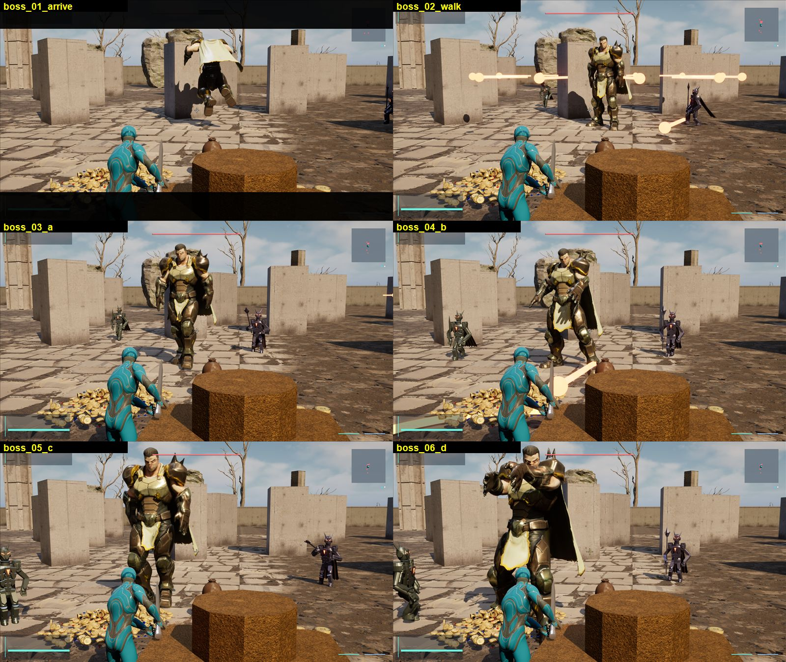

Arrival, the walk and four attack wind-ups: an armoured warrior (Fab, AI-assisted) about 2.4x a hero's height, walking with Unreal's locomotion and playing a Paragon or Mannequin clip per boss ability. Before this it was the 21-part armour rig (see the enemy sheet below for that rig).

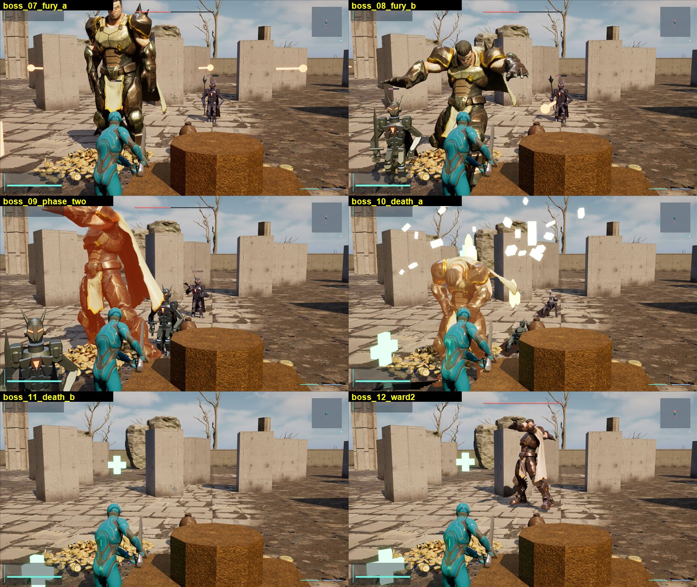

The half-health fury flex and its orange rage glow, the Mannequin death falls, and a ward-2 boss (each ward tints it). `as.boss.skeletal 0` brings the armour rig back.

## The enemies' armour is worn painted metal - `look_enemies.txt`, `look_armor.txt` (c03bb40)

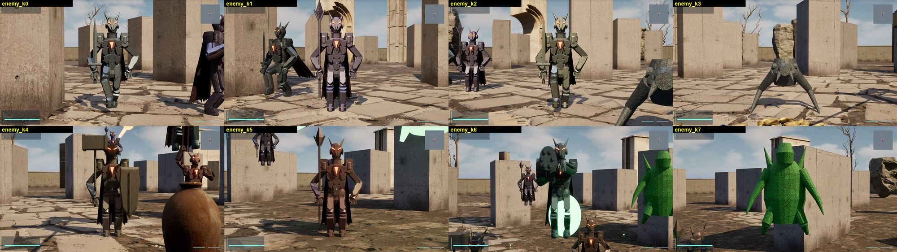

Grunt, archer, duelist, leaper, bulwark, shaman, sniper, broodcaller, frozen where they stand. The humanoid kinds' plates, weapons and shields are `M_Armor`: mottled paint, bare steel scuffed through along scratch lines, fine hammered relief, all fixed to each part so it stays put as the rig moves. The leaper and the broodcaller are single-body creatures (Tier 1 kinds: Josue's standing answer is no new creature rigs or meshes until P2 gives art direction), so they still wear the plain material.

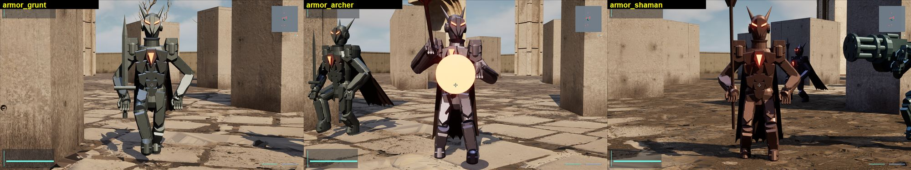

## Effects are bands of light - `look_combat.txt` (2035790)

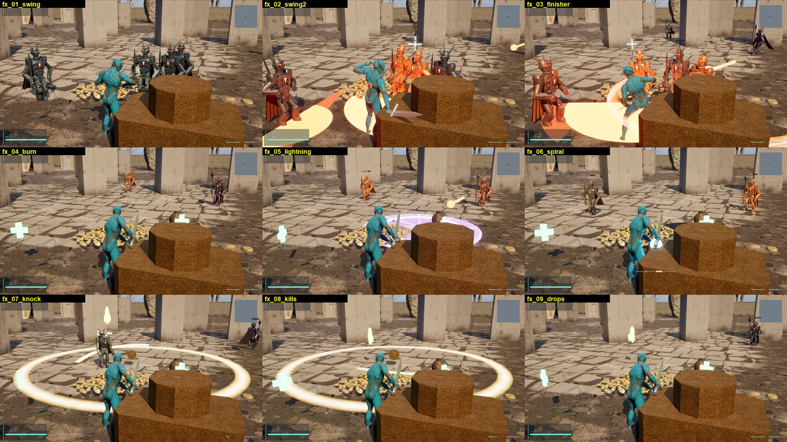

Swing arcs, slashes, shockwaves, ring flashes and the gravity well are `M_GlowBand`: soft edges or brightest along the reach, streaks running round, a white-hot line. Warnings and hazards (strike sectors, telegraph rings, sky-strike outlines) are deliberately still solid shapes - readability first.

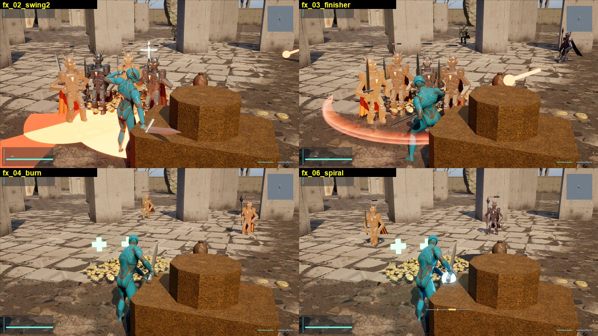

Burning, frozen, poisoned, enraged and mutated enemies glow in the status colour over their plate instead of turning orange (first try x1.2 washed them out to pale figures; x0.45 is what shipped).

## The reward chest - `look_chest.txt` (60a34d7)

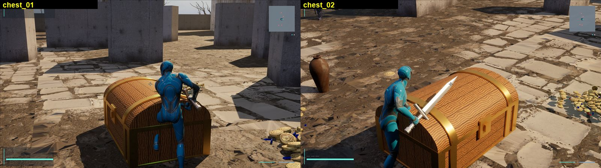

A wooden chest with a domed lid, gold bands, corner braces and a lock plate. It had been a stepped octagonal block since the first meshes (its lid cylinder was modelled standing upright). The story vault's cache is the same chest with silvered trim (**not yet photographed in-engine**).

## The hub - `look_hub.txt` (3408fa0)

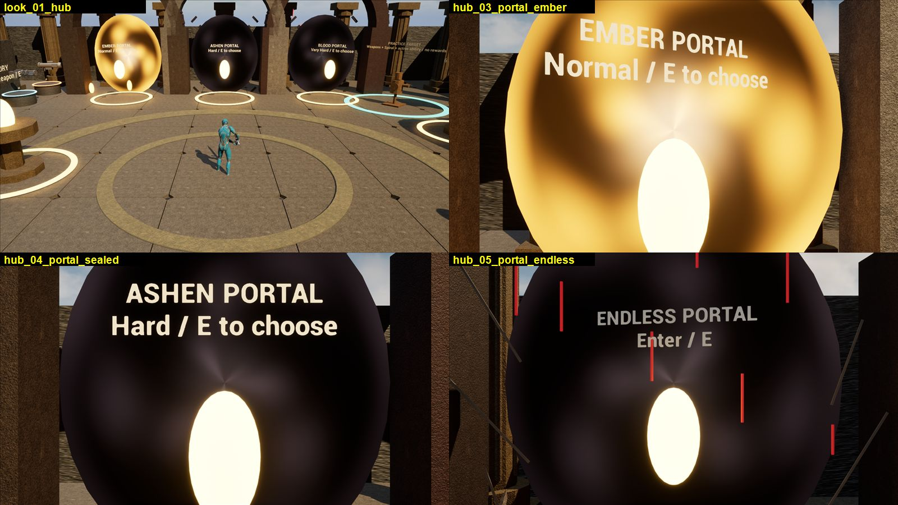

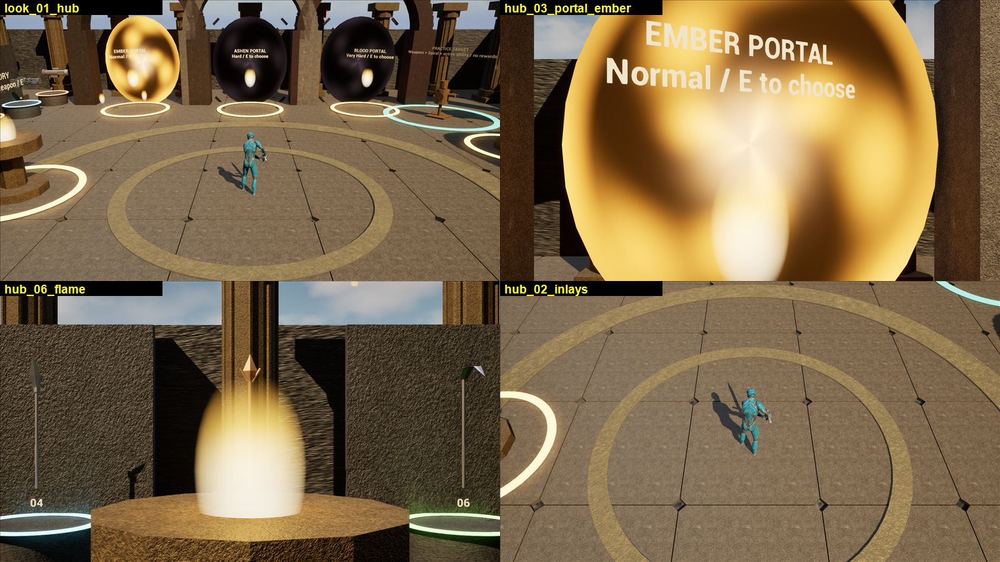

The portals are turning spiral vortices in their own colours (a sealed portal is dark, slow smoke); the stations' flames burn instead of glowing like white eggs. The Endless portal was sealed on the test profile, so its open red vortex has not been seen.

## The story chambers - `look_story.txt` (375697e)

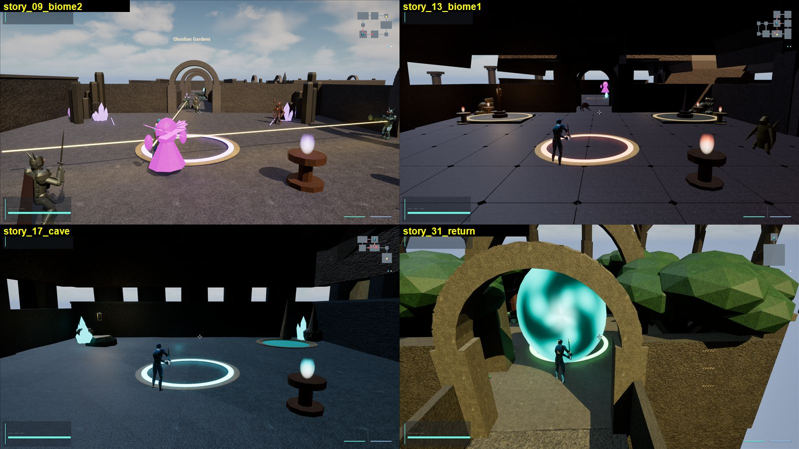

Braziers, funeral flames and lanterns burn; the final chamber's way home is a vortex like the hub's portals.

## Source mesh audit (b194363)

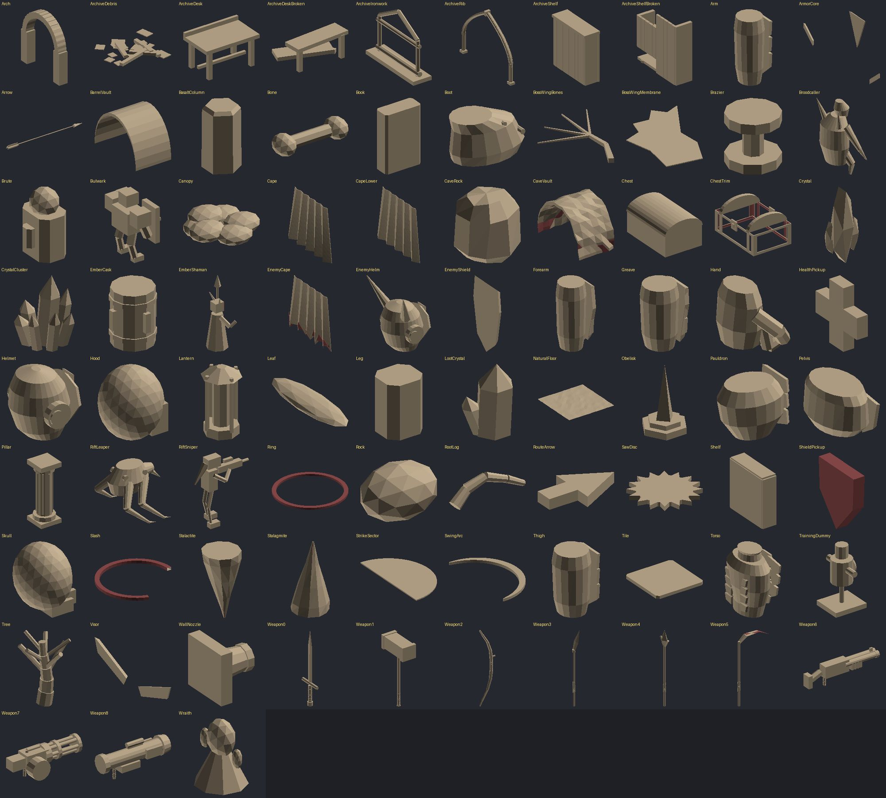

An offline render of every source mesh (back faces red) and a signed-volume check found `SM_Ring`, `SM_Slash` and `SM_ShieldPickup` inside out; fixed. The chest was the other modelling mistake (it is the "Chest" and "ChestTrim" tiles here, after the fix).
